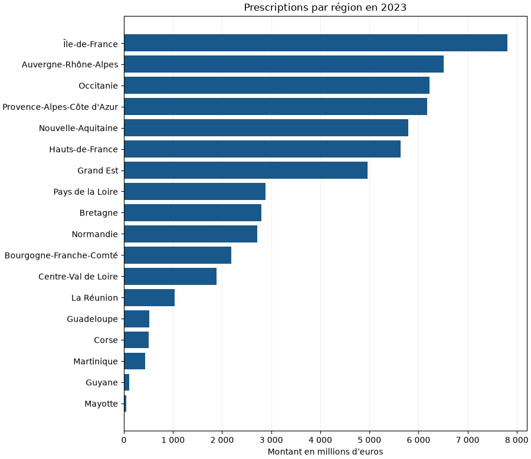

# Data Ameli · Explorer les effectifs et les prescriptions

Application Flask réalisée en équipe. Deux parcours permettent de comparer les prescriptions entre régions et de consulter les effectifs des professions de santé à partir de données agrégées de l’Assurance Maladie.

## Essayer l’extrait de démonstration

Créer puis activer un environnement virtuel avec `python -m venv .venv`. Depuis cet environnement :

~~~sh
python -m pip install -r requirements.txt
python -m flask --app app run
~~~

Sur [localhost:5000](http://127.0.0.1:5000), ouvrir **Montants des prescriptions par région**, puis passer de 2022 à 2023. L’extrait SQLite comprend quatre régions. En 2023, la barre Île-de-France correspond à **7 814 970 581 €**.

## Comprendre ce qui est comparé

La requête choisit le poste **total**, l’agrégat **Ensemble des médecins** et le code départemental **999** pour le niveau régional. La ligne de la France entière porte le code région **99**. Cette sélection évite de mélanger des niveaux d’agrégation dans le classement.

Les requêtes et les filtres sont dans `model/db.py`. Les pages et formulaires passent par `app.py`. Les graphiques sont assemblés dans `utils/graphiques.py`.

### Utiliser la base complète

~~~sh
python prepare_data.py
python -m flask --app app run
~~~

La préparation extrait SQLite de l’archive fournie `site-amelie.zip`. Le site privilégie la base complète si elle est présente. Le [dépôt de la base](https://github.com/Kajan94/database-amelie) contient le rapport de conception et des requêtes SQL d’exploration.

## Données et réutilisation

L’extrait est dérivé de données agrégées de la Cnam, sous [Open Database License 1.0](https://opendatacommons.org/licenses/odbl/1-0/). [Montants des prescriptions](https://data.ameli.fr/explore/assets/prescriptions/) · [Effectifs par mode d’exercice](https://data.ameli.fr/explore/dataset/demographie-exercices-liberaux/) · [Conditions de réutilisation](https://data.ameli.fr/terms/terms-and-conditions/)

[Projet dans le portfolio](https://kajan94.github.io/#ameli)
