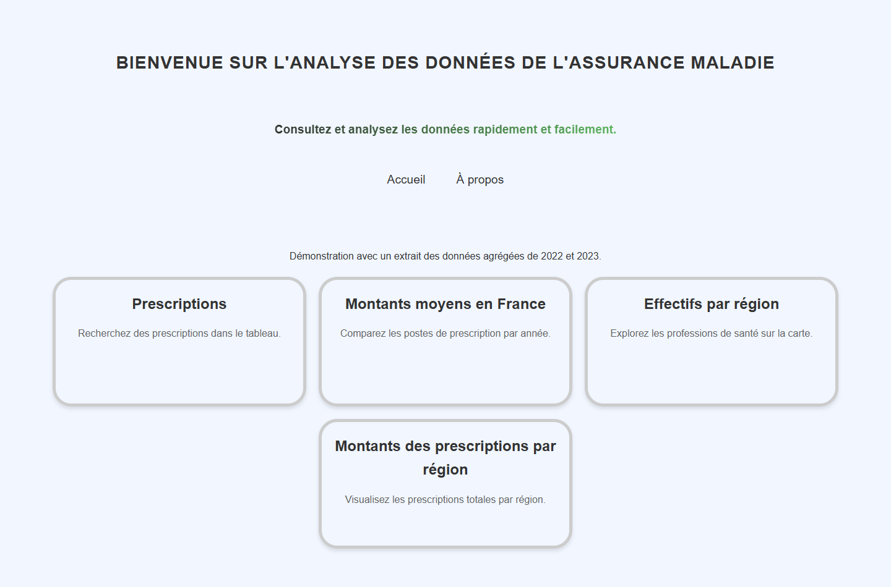
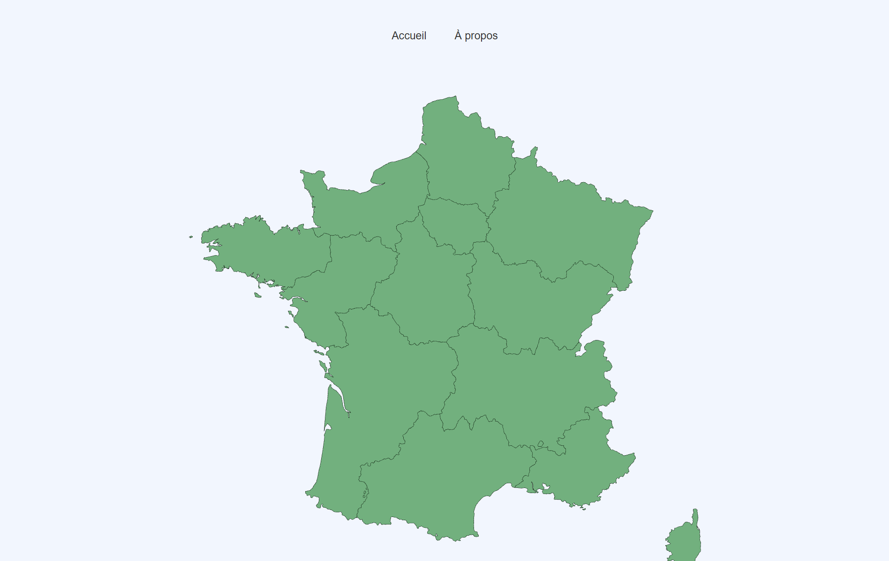
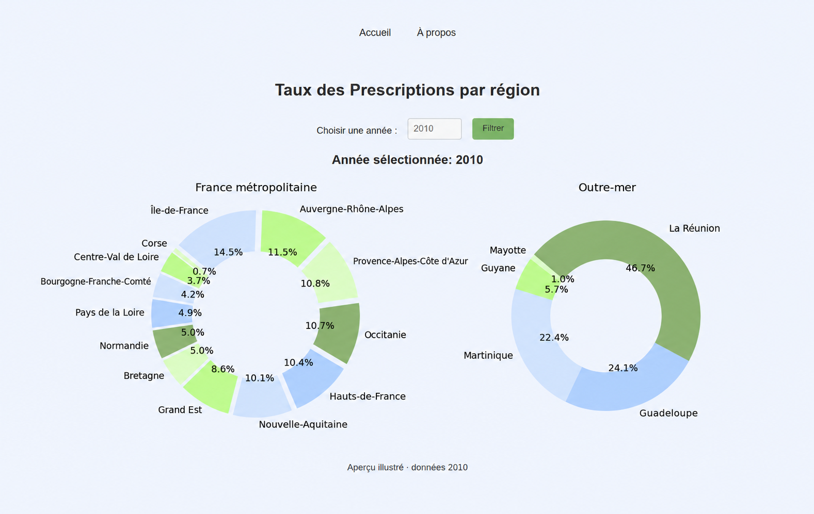

# Data Ameli · Explorer les professions de santé et les prescriptions

Data Ameli est une application web qui permet d’explorer les données agrégées de l’Assurance Maladie. L’utilisateur peut consulter les effectifs des professions de santé sur une carte des régions, comparer les montants des prescriptions entre régions et visualiser leur répartition par poste pour une année donnée.

## Aperçus du projet

### Accueil

[](docs/01-accueil.png)

Accès aux prescriptions, à l’histogramme, à la carte des régions et aux graphiques régionaux.

### Carte des régions

[](docs/02-carte-regions.png)

Sélection d’une région sur la carte pour consulter les professions de santé associées.

### Prescriptions par région

[](docs/04-prescriptions-regions.png)

Répartition des montants des prescriptions en 2023 pour l’ensemble des médecins : 13 régions métropolitaines et 5 régions d’outre-mer. Les pourcentages sont calculés séparément dans chaque groupe.

## Lancer en local

Préparer **Python 3.12**. [Télécharger le dépôt](https://github.com/Kajan94/site-amelie/archive/refs/heads/main.zip), le décompresser, puis ouvrir un terminal à sa racine, dans le dossier `site-amelie`. Le ZIP inclut le code et la base complète.

Installer les bibliothèques et lancer l’application :

```sh
python -m pip install -r requirements.txt
python app.py
```

Sur macOS ou Linux, utiliser `python3` à la place de `python` si nécessaire.

Ouvrir [localhost:5000](http://127.0.0.1:5000). Aucun compte ni serveur de base de données n’est nécessaire. Aucun script de préparation ni import de données n’est à lancer.

Les données réelles agrégées couvrent **2010 à 2023**. La carte permet de consulter les effectifs des **18 régions**, et les graphiques utilisent la base complète.

## Fonctionnalités

- **Professions de santé** : choisir une région sur la carte, puis cocher ou décocher les professions à afficher. Le tableau présente les effectifs et les modes d’exercice pour la dernière année disponible.
- **Prescriptions par région** : sélectionner une année et consulter deux graphiques en anneaux, l’un pour les régions métropolitaines et l’autre pour l’outre-mer. Chaque graphique présente la répartition des montants au sein de son groupe, pour l’ensemble des médecins.
- **Montants moyens par poste** : consulter un histogramme vertical national par catégorie de prescription pour l’année choisie, exprimé en milliers d’euros.
- **Aperçu des prescriptions** : rechercher dans un tableau limité à 200 lignes au maximum. Cette limite concerne l’aperçu ; les graphiques interrogent les agrégats de la base.

## Organisation du code

Flask reçoit les demandes de l’utilisateur, pandas prépare les résultats des requêtes SQLite et Matplotlib produit les graphiques. Les pages utilisent HTML, CSS et JavaScript.

| Chemin | Rôle |
| --- | --- |
| `app.py` | Routes, formulaires et transmission des résultats aux pages. |
| `model/db.py` | Connexion SQLite et requêtes sur les effectifs et les prescriptions. |
| `utils/graphiques.py` | Génération des graphiques avec Matplotlib. |
| `templates/` et `static/` | Pages, carte et interactions de l’interface. |
| `model/data/ameli.db` | Base SQLite intégrale, ouverte directement par l’application. |

Pour la conception et l’exploration SQL, consulter le [dépôt consacré à la base de données](https://github.com/Kajan94/database-amelie).

## Travail en équipe

Projet universitaire réalisé en groupe en **première année de BUT Informatique** à l’IUT de Créteil-Vitry (UPEC). Le travail a porté sur l’interrogation des données de santé et leur restitution dans une application web avec une carte, des tableaux et des graphiques.
