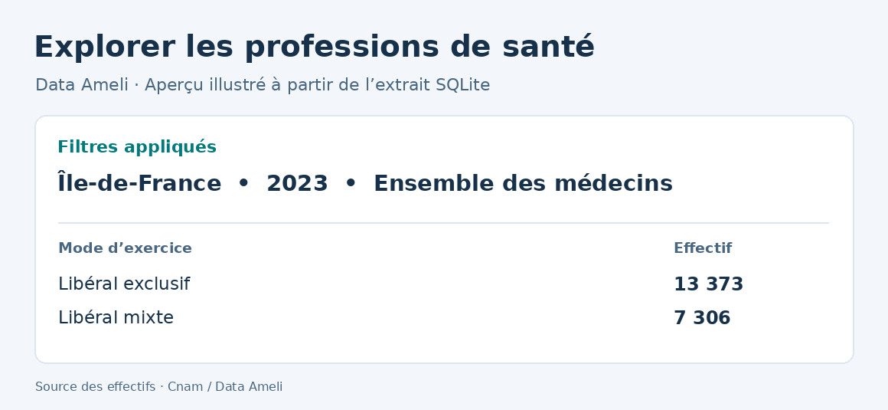

# Data Ameli · Explorer les effectifs et les prescriptions

Application Flask réalisée en équipe. Deux parcours permettent de comparer les prescriptions entre régions et de consulter les effectifs des professions de santé à partir de données agrégées de l’Assurance Maladie.

## Lancer en local

Prérequis : Python 3.12, version utilisée pour la vérification du projet. Télécharger le dépôt ou le cloner, puis ouvrir un terminal dans le dossier `site-amelie`.

### Windows PowerShell

~~~powershell
python -m venv .venv
.\.venv\Scripts\python.exe -m pip install -r requirements.txt
.\.venv\Scripts\python.exe -m flask --app app run
~~~

### macOS ou Linux

~~~sh
python3 -m venv .venv
source .venv/bin/activate
python -m pip install -r requirements.txt
python -m flask --app app run
~~~

Ouvrir [localhost:5000](http://127.0.0.1:5000). Aucun compte ni serveur MySQL n’est nécessaire : l’application lit une base SQLite locale.

### Comprendre l’extrait fourni

Au premier lancement, le site utilise `demo/amelie-demo.sqlite`. Il contient un **extrait des données réelles agrégées**, avec les prescriptions de 2022 et 2023 et les effectifs de 2023 pour l’Île-de-France, les Hauts-de-France, Auvergne-Rhône-Alpes et La Réunion. Les totaux nationaux nécessaires au graphique par poste sont également conservés.

Ce fichier permet de tester l’application immédiatement. Le script `demo/creer_extrait.py` sert à reconstruire cet extrait à partir de la base complète ; il n’est pas nécessaire pour lancer le site.

Ouvrir **Montants des prescriptions par région**, puis passer de 2022 à 2023. En 2023, la barre Île-de-France correspond à **7 814 970 581 €**.

## Explorer les professions de santé

Ouvrir la vue des professions, sélectionner une région sur la carte, puis cocher ou décocher les professions à afficher. Les résultats indiquent les effectifs et le mode d’exercice pour la dernière année disponible. Les modes d’exercice correspondent à des catégories distinctes : leurs effectifs ne doivent pas être additionnés sans vérifier leur périmètre. Avec l’extrait, les autres régions affichent un message signalant l’absence de données.

pandas prépare les résultats, Flask sert les pages et Matplotlib génère les graphiques de prescriptions.

Le projet comprend aussi un tableau de bord Excel sur les effectifs. J’y ai travaillé sur le nettoyage des données, les indicateurs et les tableaux croisés dynamiques. [Voir la fiche Data Ameli](https://kajan94.github.io/Portefolio/#ameli)

## Comprendre ce qui est comparé

La requête choisit le poste **total**, l’agrégat **Ensemble des médecins** et le code départemental **999** pour le niveau régional. La ligne de la France entière porte le code région **99**. Cette sélection évite de mélanger des niveaux d’agrégation dans le classement.

Les requêtes et les filtres sont dans `model/db.py`. Les pages et formulaires passent par `app.py`. Les graphiques sont assemblés dans `utils/graphiques.py`.

## Utiliser la base complète

Arrêter le serveur avec `Ctrl+C`. Sous Windows PowerShell :

~~~powershell
.\.venv\Scripts\python.exe prepare_data.py
.\.venv\Scripts\python.exe -m flask --app app run
~~~

Sous macOS ou Linux, avec l’environnement virtuel activé :

~~~sh
python prepare_data.py
python -m flask --app app run
~~~

La préparation extrait la base originale de l’archive fournie `site-amelie.zip` vers `model/data/debase_db.sqllite3` (environ 278 Mo). Au redémarrage, le site privilégie ce fichier. Les données couvrent 2010 à 2023 ; le graphique régional présente alors les 18 régions en 2023. Les effectifs affichés restent ceux de la dernière année disponible.

La page **Prescriptions** affiche seulement un aperçu de 200 lignes au maximum : la recherche porte sur cet aperçu. Les graphiques interrogent directement les agrégats de la base et ne sont pas limités à ces 200 lignes. Les données d’honoraires sont présentes dans la base complète et peuvent être interrogées en SQL ; l’interface web se concentre sur les prescriptions et les effectifs.

Le [dépôt de la base](https://github.com/Kajan94/database-amelie) contient le rapport de conception, le schéma SQL et des requêtes d’exploration.

## Données et réutilisation

L’extrait est dérivé de données agrégées de la Cnam, sous [Open Database License 1.0](https://opendatacommons.org/licenses/odbl/1-0/). [Montants des prescriptions](https://data.ameli.fr/explore/assets/prescriptions/) · [Effectifs par mode d’exercice](https://data.ameli.fr/explore/dataset/demographie-exercices-liberaux/) · [Conditions de réutilisation](https://data.ameli.fr/terms/terms-and-conditions/)

[Projet dans le portfolio](https://kajan94.github.io/Portefolio/#ameli)
